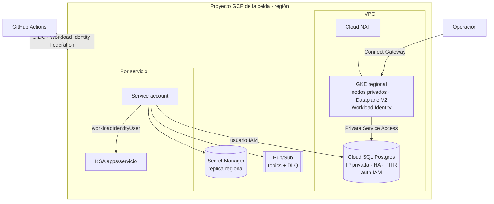

# Celdas en Google Cloud con Terraform

Infraestructura como código para una plataforma organizada en **celdas**: cada celda es un
proyecto de GCP en una región, con su propia red, su cluster GKE, su base PostgreSQL y su
mensajería. Las celdas no comparten recursos: un incidente o un cambio malo queda acotado a una
región, y los datos de cada región no salen de ella.

Es la contraparte de [`gitops-multicell`](../gitops-multicell/): este proyecto crea la celda y la
identidad de cada servicio, y el repo de GitOps despliega los servicios sobre ella.

## Arquitectura de una celda



## Estructura

```
cloud/
├── bootstrap/            # por proyecto: bucket del state + WIF para GitHub Actions (una vez, a mano)
├── modules/
│   ├── network/          # VPC, subred con rangos para GKE, Cloud NAT, Private Service Access
│   ├── gke-cell/         # cluster privado, node pool, SA mínima para nodos, registro en la flota
│   ├── cloudsql/         # Postgres privado con HA, backups, PITR, auth IAM y logging
│   ├── workload/         # todo lo de un servicio: identidad, permisos, secretos, base, Pub/Sub
│   │   └── tests/        # terraform test con provider simulado
│   └── cell/             # compone los anteriores en una celda completa
│       └── tests/
└── cells/
    ├── dev-us-1/         # main.tf + terraform.tfvars + backend propio
    ├── staging-us-1/
    ├── prod-us-1/
    └── prod-eu-1/
```

**Dar de alta un servicio** es agregar una entrada al mapa `workloads` del `terraform.tfvars` de la
celda:

```hcl
workloads = {
  payments-api = {
    database      = true                 # base propia + usuario IAM, sin contraseña
    secrets       = ["provider-api-key"] # contenedor en Secret Manager, acceso solo para este servicio
    subscribes    = ["order-events"]     # suscripción con reintentos y dead-letter topic
    project_roles = ["roles/cloudtrace.agent"]
  }
}
```

## Decisiones de diseño

| Decisión | Por qué |
|---|---|
| **Un state por celda** (bucket por proyecto, prefijo por celda) | Un `plan` o un `apply` nunca puede tocar dos celdas a la vez, y un state roto afecta a una sola. |
| **Las raíces de las celdas son idénticas**: solo cambia el `tfvars` | Las diferencias entre ambientes quedan a la vista en un archivo de datos, no escondidas en código. La CI verifica que las variables de cada raíz sean copia exacta de las del módulo. |
| **Base de datos con autenticación IAM** | Los servicios se conectan con el token de su service account: no hay contraseñas que rotar, guardar ni filtrar. |
| **Secretos sin valores en Terraform** | Terraform crea el contenedor y da acceso solo al servicio dueño; el valor se carga por otro canal y nunca queda en el state. |
| **Réplica regional de secretos y de mensajes de Pub/Sub** | Residencia de datos: lo de la celda europea se queda en Europa. |
| **Dead-letter topic en cada suscripción**, con los permisos del agente de Pub/Sub | Un mensaje envenenado no bloquea la cola. Sin los permisos del agente, el DLQ "existe" pero los mensajes nunca llegan: es un error común y fácil de no ver. |
| **Nodos privados, Cloud NAT y Connect Gateway** | Nada del cluster tiene IP pública. Se opera con `kubectl` vía la flota sin abrir el endpoint del plano de control. |
| **Node pool con service account propia y mínima** | La SA default de Compute tiene permisos de editor; un pod que escape al nodo no hereda eso. |
| **Canal RAPID en dev, STABLE en staging/prod** | Las incompatibilidades de una versión nueva de GKE aparecen primero en dev. |
| **Staging con la forma de prod** (HA, canal, deletion protection) | Un problema de topología aparece en staging, no en prod. |
| **CI sin llaves** (Workload Identity Federation) | GitHub Actions se autentica con el token OIDC del job. El `plan` usa una SA de solo lectura; el `apply` solo puede correr desde `main`, y en prod con aprobación. |

## Calidad y CI

`.github/workflows/cloud.yml`:

| Etapa | Qué hace |
|---|---|
| `terraform fmt` | Formato. |
| `terraform test` | Tests de los módulos con **provider simulado**: verifica el binding de Workload Identity, la réplica regional de los secretos, los permisos del agente de Pub/Sub sobre la DLQ y las validaciones (topics no declarados, roles primitivos, nombres de celda). Corren en segundos, sin credenciales. |
| `terraform validate` | Cada celda y el bootstrap. |
| `tflint` | Lint con las reglas del ruleset de Terraform. |
| `trivy config` | Escaneo de seguridad de la configuración. Hoy: 0 hallazgos MEDIUM, HIGH o CRITICAL; la única excepción está documentada en el código. |
| `plan` (PR) | `plan` de cada celda con la SA de solo lectura; el resumen queda en el job. |
| `apply` (manual) | Una celda por vez, solo desde `main`, con aprobación en prod (GitHub environments). |

## Probarlo en local

```bash
cd cloud/modules/cell && terraform init -backend=false && terraform test   # sin credenciales
cd cloud/cells/dev-us-1 && terraform init -backend=false && terraform validate
```

Para aplicarlo de verdad: correr `bootstrap/` en el proyecto (con `project_id`, `state_location` y
`github_repository`), cargar las variables del environment en GitHub y lanzar el workflow `cloud`
con la celda.
