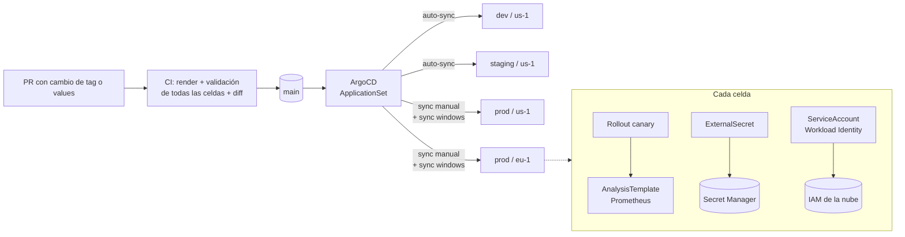

# GitOps multi-celda con ArgoCD y Argo Rollouts

Plataforma GitOps para desplegar microservicios en **varias celdas regionales** (clusters
independientes por región y ambiente) desde un único repositorio. Un solo `ApplicationSet` genera
todas las aplicaciones a partir de la estructura de carpetas, y cada despliegue avanza como
**canary con análisis automático de métricas**: si la versión nueva empeora la tasa de error, se
revierte sola.

## Arquitectura



## Estructura

```
gitops-multicell/
├── argocd/
│   ├── bootstrap/root-app.yaml        # lo único que se aplica a mano
│   ├── projects/projects.yaml         # AppProjects nonprod / prod (destinos, recursos, sync windows)
│   └── applicationsets/services.yaml  # genera una Application por (ambiente, celda, servicio)
├── charts/service/                    # chart genérico de microservicio
├── environments/
│   ├── <env>/env-values.yaml          # defaults del ambiente
│   └── <env>/<celda>/
│       ├── cell-values.yaml           # región, proyecto de nube
│       └── services/<servicio>.yaml   # imagen y configuración del servicio en esa celda
└── scripts/render-all.sh              # render + validación de todas las combinaciones
```

**Sumar un servicio a una celda es agregar un archivo.** Sumar una celda es crear su carpeta y
registrar el cluster en ArgoCD con el nombre `<env>-<celda>`. No se toca YAML de ArgoCD.

## Decisiones de diseño

| Decisión | Por qué |
|---|---|
| **Celdas** (un cluster por región y ambiente) en vez de un cluster global | Limita el radio de impacto de un incidente a una región y permite residencia de datos por región. |
| **Un ApplicationSet dirigido por carpetas** | Cero duplicación: la topología se lee del árbol de directorios, y un PR que agrega un archivo muestra exactamente qué se despliega dónde. |
| **Values en capas** (chart → ambiente → celda → servicio) y `env` como mapa | Cada capa pisa solo lo que le corresponde. Las variables son un mapa para que las capas se sumen; con listas, Helm reemplaza la lista completa. |
| **Tags inmutables, nunca `latest`** | Con un tag móvil, dos syncs de la misma revisión de git pueden correr código distinto. El chart falla el render si recibe `latest` o un tag vacío. |
| **Promoción = PR que cambia el tag** | La historia de git es el registro de qué versión corrió en cada celda y cuándo; revertir es un `git revert`. |
| **Auto-sync fuera de prod, sync manual en prod** | Iteración rápida en dev/staging; en prod un humano decide el momento, y las *sync windows* bloquean despliegues de fin de semana. |
| **Canary con `AnalysisTemplate` de Prometheus** | El rollback por tasa de error es automático. Staging corre el mismo gate que prod, así un canary malo se aborta antes de llegar a prod. |
| **External Secrets + Secret Manager** | El repo nunca contiene secretos. Si a un secreto le falta versión, el ExternalSecret falla y el rollout no avanza: el error es temprano y visible. |
| **Workload Identity** | Los pods se autentican contra la nube con su propia identidad; no hay llaves de service account guardadas en el cluster. |
| **AppProjects por ambiente** | Un values de dev no puede apuntar a un cluster de prod ni crear recursos fuera de la lista permitida. |
| **Contenedores endurecidos** | Non-root, `readOnlyRootFilesystem`, sin capabilities, `seccomp` por defecto, y sin token de la API de Kubernetes montado. |

## CI

`.github/workflows/gitops-multicell.yml` corre en cada PR:

1. `helm lint` del chart.
2. `scripts/render-all.sh`: renderiza **cada combinación ambiente/celda/servicio** con el mismo
   orden de values que usa ArgoCD y la valida con `kubeconform`, contra los esquemas de Kubernetes
   y los de los CRDs (Rollout, AnalysisTemplate, ExternalSecret). Además rechaza tags `latest`.
3. **Diff de manifiestos renderizados contra `main`**, publicado en el resumen del job. Lo que se
   revisa es el impacto real en cada celda, no solo el diff del values.

## Probarlo en local

```bash
./scripts/render-all.sh                    # valida todas las celdas
OUT=rendered ./scripts/render-all.sh       # y deja los manifiestos en ./rendered
```

Con un cluster local (kind o k3d) con ArgoCD, Argo Rollouts y External Secrets instalados, se
registra el cluster con el nombre de una celda (`dev-us-1`) y se aplica
`argocd/bootstrap/root-app.yaml`.
